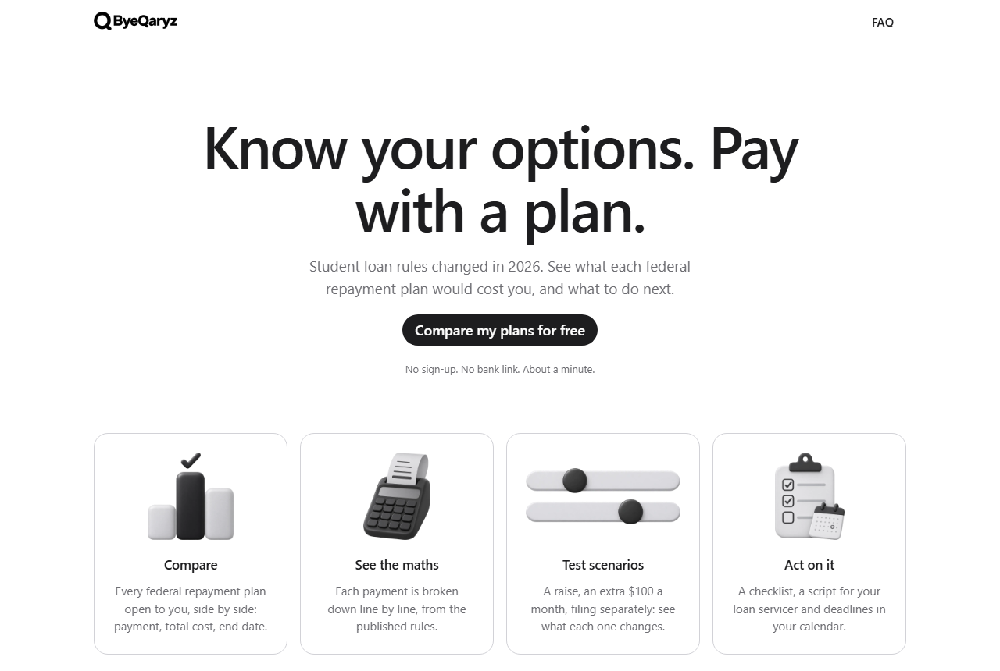
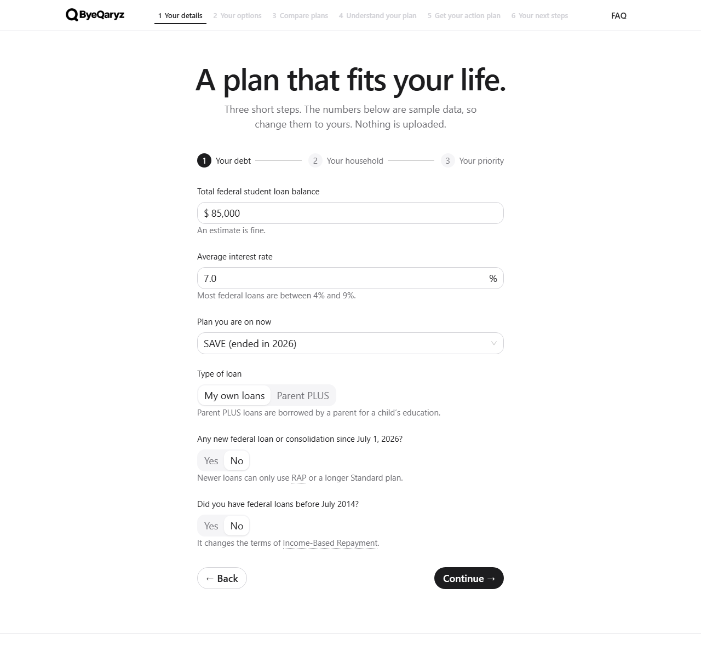
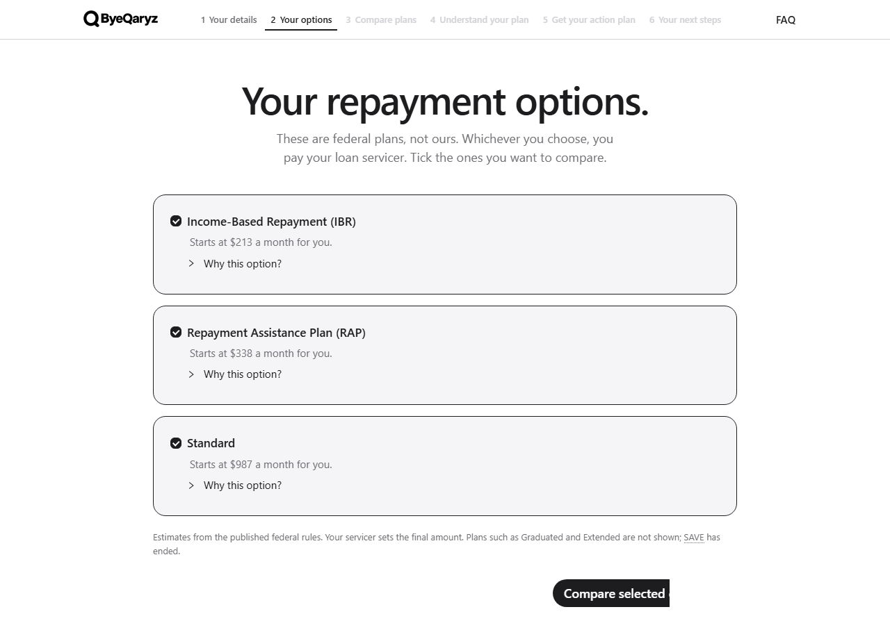
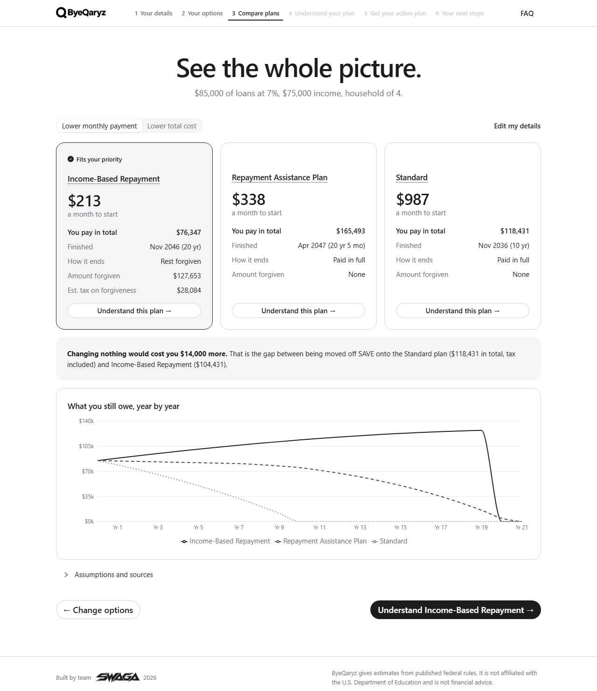
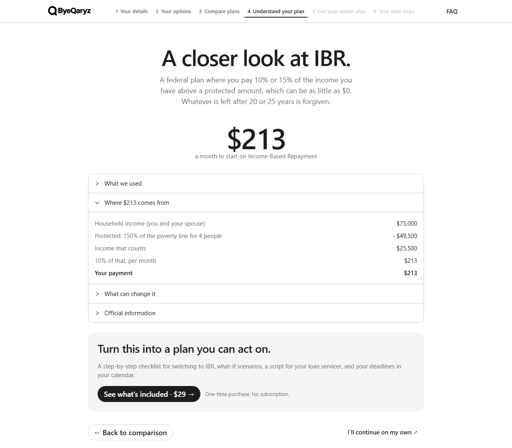
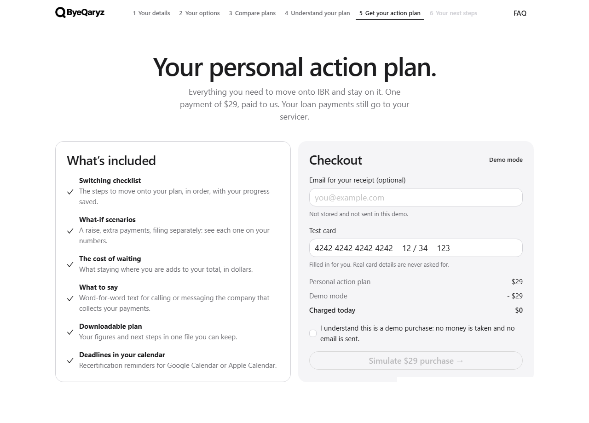
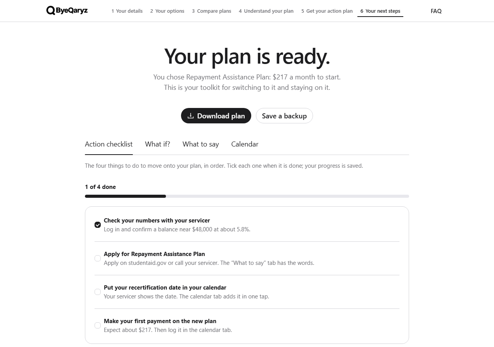
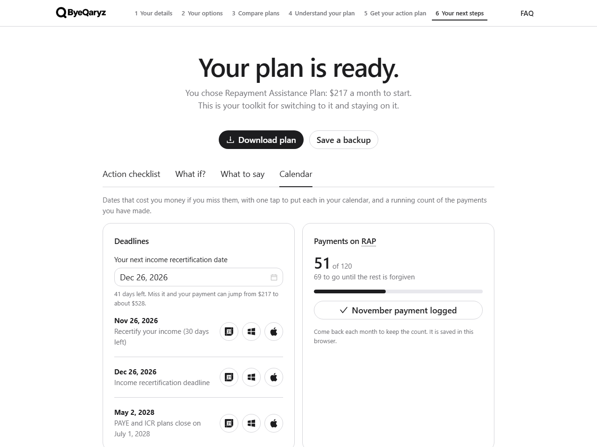

# ByeQaryz

Compare US federal student loan repayment plans, see how every number is
calculated, and get a plan you can act on.

**Live product: [byeqaryz.onrender.com](https://byeqaryz.onrender.com)**



The repayment rules changed in 2026: the SAVE plan ended and the Repayment
Assistance Plan (RAP) opened on July 1. ByeQaryz shows a borrower what each
plan open to them costs, explains the arithmetic, and turns the choice into a
checklist, a script for their loan servicer and deadlines in their calendar.

Track: Money. User: working adults aged 25 to 45 in the US with federal student
debt. Built by team SWAGA for Business Cup 2.0.

## The journey

Six screens after the intro. The first four are free; the fifth is the paywall.

| Step | Screen | What happens | Price |
|---|---|---|---|
| 0 | Intro | Start, or open a sample borrower | Free |
| 1 | Your details | Debt, household, priority: three short stages | Free |
| 2 | Your options | The federal plans open to you, and why the others are closed | Free |
| 3 | Compare plans | Payment, total cost, end date and forgiveness, side by side | Free |
| 4 | Understand your plan | The payment broken down line by line, and what can change it | Free |
| 5 | Get your action plan | What is included, and a demo checkout | $29, one time |
| 6 | Your next steps | Checklist, what-if scenarios, what to say, calendar and payment count | Included |

The repayment plans (Standard, IBR, RAP) are federal programmes: the borrower
pays their loan servicer. What we sell is the action plan.

### 1. Your details

Three short stages. The fields are filled with sample data that can be edited.



### 2. Your options

Plans the borrower can use are ticked; a plan that is closed to them says why.



### 3. Compare plans

Payment, total cost, end date and forgiveness for each plan, what doing nothing
costs, and the balance year by year.



### 4. Understand your plan

The payment broken down into the steps the rules prescribe.



### 5. Get your action plan

The paywall: what is included and a checkout in demo mode.



### 6. Your next steps

The action plan itself. The checklist keeps its progress between visits.



Deadlines go to Google Calendar, Outlook or Apple Calendar in one tap, and the
payment count is the reason to come back every month.



## For the jury

- No sign-up or login. Everything runs in the browser.
- **Sample data:** the intro has four sample borrowers. They go through the same
  engine as typed input, and every field can be edited.
- **Checkout is in demo mode.** A test card is filled in, nothing is charged and
  no email is sent. Tick the box and press "Simulate $29 purchase".
- **Return mechanic:** the checklist and the monthly payment count are saved in
  the browser, and deadlines go to the borrower's own calendar.
- **Direct links:** `/?demo=family&step=3` opens a sample borrower on a given
  screen (`demo`: `teacher`, `family`, `starter`, `earner`; `step`: 1 to 6;
  on step 6, `tab`: `checklist`, `whatif`, `script`, `calendar`).

## How it works

- **No AI and no backend.** A deterministic engine computes every figure in the
  browser. Nothing the user types is uploaded.
- **State** is kept in `localStorage` on the user's device.
- **Stack:** React, TypeScript, Vite, Ant Design, Recharts, Day.js,
  simple-icons (calendar logos), Vitest.

## Project structure

```text
byeqaryz/
├── index.html                    Page shell and metadata
├── package.json                  Scripts and dependencies
├── vite.config.ts                Build configuration
├── tsconfig*.json                TypeScript configuration
├── .oxlintrc.json                Linter rules
├── .prettierrc                   Formatter settings
│
├── docs/
│   └── screens/                  Screenshots used in this README
│
├── public/                       Files served as they are
│   ├── logo.png                  ByeQaryz wordmark (header)
│   ├── mark.png                  ByeQaryz mark (browser tab icon)
│   ├── team.png                  Team SWAGA logo (footer)
│   └── art/                      Illustrations on the intro screen
│
└── src/
    ├── main.tsx                  Entry point
    ├── App.tsx                   Theme, header with step navigation, footer
    ├── brand.ts                  Product name, price, links to the sources
    ├── index.css                 Monochrome styles and layout
    │
    ├── engine/                   The calculation. No UI, no browser APIs
    │   ├── types.ts              Borrower, plan result, comparison
    │   ├── rules.ts              Every number from law or regulation, with its source
    │   ├── simulate.ts           Month-by-month simulation of Standard, IBR and RAP
    │   ├── compare.ts            Eligibility, the comparison, the cost of doing nothing
    │   ├── explain.ts            The step-by-step arithmetic behind a payment
    │   └── engine.test.ts        Tests, including figures from the official calculator
    │
    ├── lib/                      Helpers with no UI
    │   ├── actionPlan.ts         Checklist, reminders, payment count, what-if
    │   ├── actionPlan.test.ts    Tests for the above
    │   ├── calendar.ts           Google and Outlook links, calendar file
    │   ├── planFile.ts           The downloadable plan and the backup
    │   ├── download.ts           Saves a generated file from the browser
    │   └── format.ts             Dollars, durations, dates
    │
    ├── data/                     Content
    │   ├── personas.ts           Sample borrowers
    │   ├── glossary.ts           Plain-language explanations of loan terms
    │   └── templates.ts          Scripts for calling or messaging the servicer
    │
    ├── state/
    │   └── store.tsx             App state, step navigation, demo links, local storage
    │
    ├── components/               Pieces shared by several screens
    │   ├── ui.tsx                Screen intro, label and value lines, tab note
    │   ├── Term.tsx              A term with its explanation on hover
    │   ├── BalanceChart.tsx      Balance owed, year by year
    │   ├── CalendarButtons.tsx   Google, Outlook and Apple buttons for a reminder
    │   └── FaqModal.tsx          Questions and answers
    │
    └── screens/                  One file per screen of the journey
        ├── Intro.tsx             0. Start, or open sample data
        ├── Details.tsx           1. The questionnaire
        ├── Options.tsx           2. Plans open to the borrower
        ├── Compare.tsx           3. Plans side by side
        ├── Understand.tsx        4. One plan in detail
        ├── Purchase.tsx          5. The paywall and demo checkout
        ├── NextSteps.tsx         6. The action plan
        └── plan/                 The four tabs of the action plan
            ├── Checklist.tsx
            ├── WhatIf.tsx
            ├── Scripts.tsx
            └── Calendar.tsx
```

The dependency direction is one way: `screens` and `components` use `lib`,
`data` and `engine`; `engine` uses nothing but itself.

## Accuracy

The engine is tested against figures read from the official
[Repayment Calculator](https://studentaid.gov/repayment-calculator/) on
2026-11-14. Standard, Tiered Standard and RAP totals match to within 0.05%;
IBR totals and forgiven amounts match to within 1% (the official tool projects
poverty guidelines with CBO inflation forecasts; we use a flat 2.4% a year).

Not modelled: a spouse's own federal loans, the Graduated and Extended plans,
and state income tax. Parent PLUS borrowers are shown the Standard plan only.

## Run it

```bash
npm install
npm run dev     # local development
npm test        # engine and action plan tests
npm run build   # production build in dist/
```

ByeQaryz gives estimates from published federal rules. It is not affiliated
with the U.S. Department of Education and is not financial advice.
